 

 

## About

I build AI systems that run on the hardware you already own: no cloud API, no data leaving the device.

- **Now:** building [Kestrel](https://github.com/adi-mauryaji/Kestrel), an on-device assistant for notes and tasks that understands English and Hinglish.
- **Interested in:** small language models on CPU-only machines, retrieval (vector search + knowledge graphs), and cheap-first inference cascades.
- **How I work:** measured, not guessed. Pinned models, frozen experiments, and numbers anyone can reproduce.
- **Also ship:** Android apps in Kotlin and web apps in React + TypeScript.

## Featured work

<table>
<tr>
<td width="50%" valign="top">

### [Kestrel](https://github.com/adi-mauryaji/Kestrel)
Local-first assistant for your notes and tasks. Each request goes through a cascade: keyword rules, then a sentence encoder, then a local LLM only when the cheaper tiers aren't sure. Most requests are answered in milliseconds, and nothing leaves the machine.

`Rust` `Python` `llama.cpp` `Gemma` `SQLite`

</td>
<td width="50%" valign="top">

### [Knowledge-Graph RAG](https://github.com/adi-mauryaji/KNOWLEDGE-GRAPH-RAG-SYSTEM)
Question answering over your own documents. Combines vector similarity search with knowledge-graph traversal to give cited, hallucination-resistant answers.

`Python` `FastAPI` `LlamaIndex` `Qdrant` `Streamlit`

</td>
</tr>
<tr>
<td width="50%" valign="top">

### [ReviZen](https://github.com/adi-mauryaji/ReviZen)
An offline study workspace for Android: spaced-repetition reviews, habit tracking, memory palaces, notes, and learning analytics.

`Kotlin` `Android` `Clean Architecture` `MVVM`

</td>
<td width="50%" valign="top">

### [Stray Animal Rescue](https://github.com/adi-mauryaji/stray-animal-rescue-system)
Real-time rescue platform that matches reports to nearby responders by geolocation, coordinates the rescue automatically, and sends live notifications.

`Python` `Geolocation` `Real-time`

</td>
</tr>
</table>

## Toolbox

| | |
|:--|:--|
| **AI / ML** |  |
| **Systems** |  |
| **Mobile** |  |
| **Web** |  |
| **Tools** |  |

## Contributions

<picture>
  <source media="(prefers-color-scheme: dark)" srcset="https://raw.githubusercontent.com/adi-mauryaji/adi-mauryaji/output/snake-dark.svg" />
  <source media="(prefers-color-scheme: light)" srcset="https://raw.githubusercontent.com/adi-mauryaji/adi-mauryaji/output/snake-light.svg" />
  
</picture>

